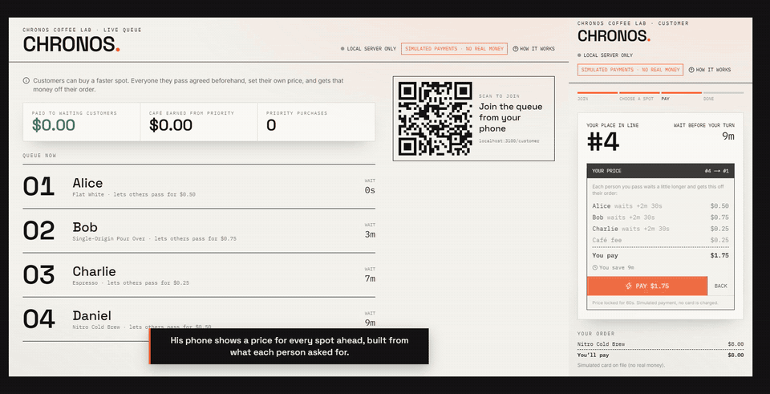
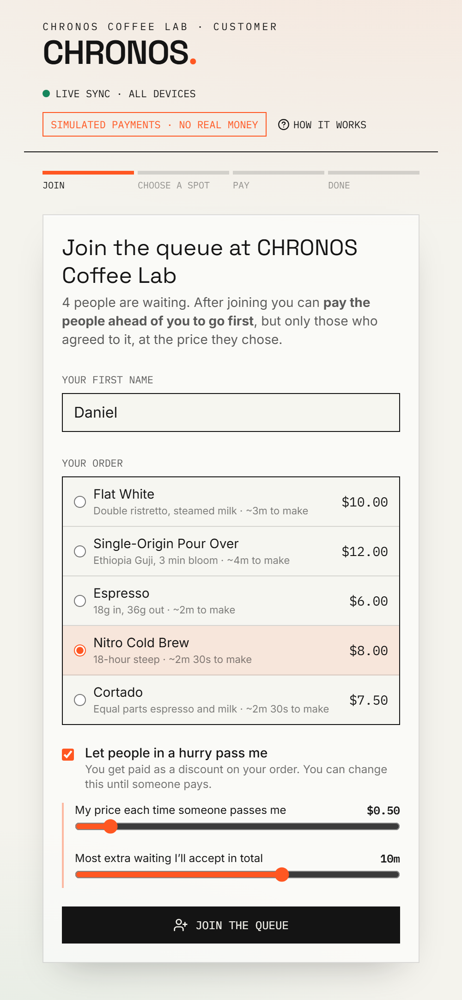
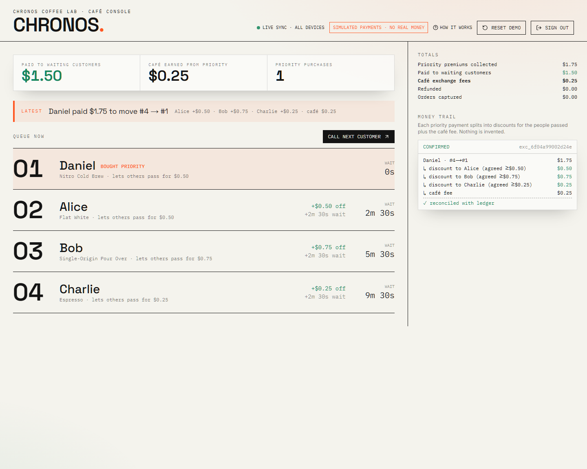
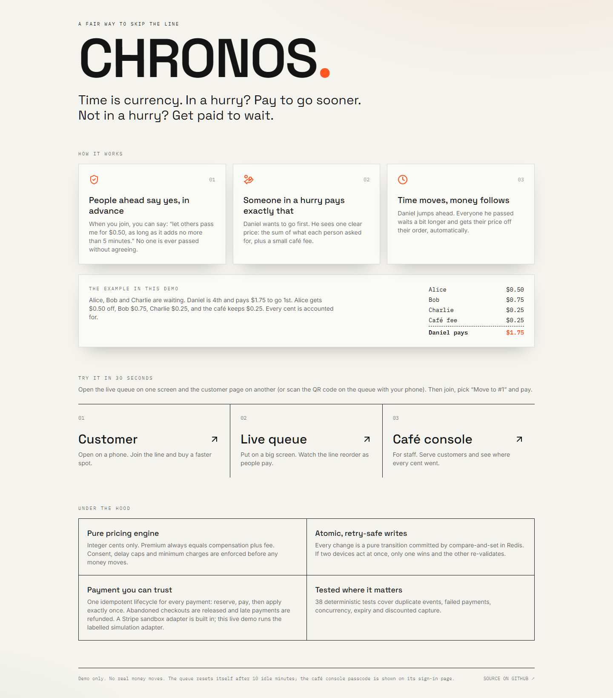
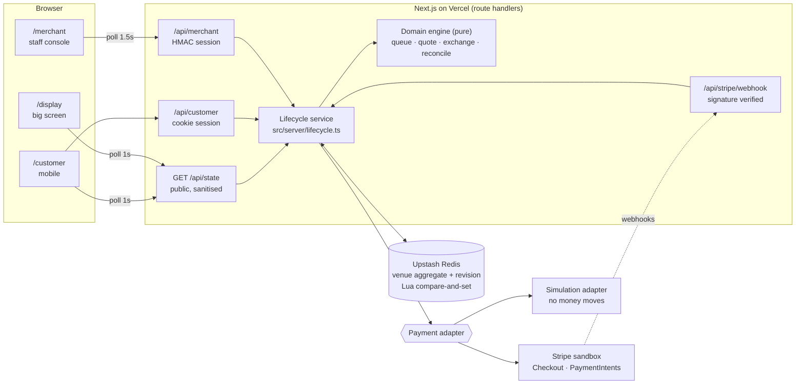
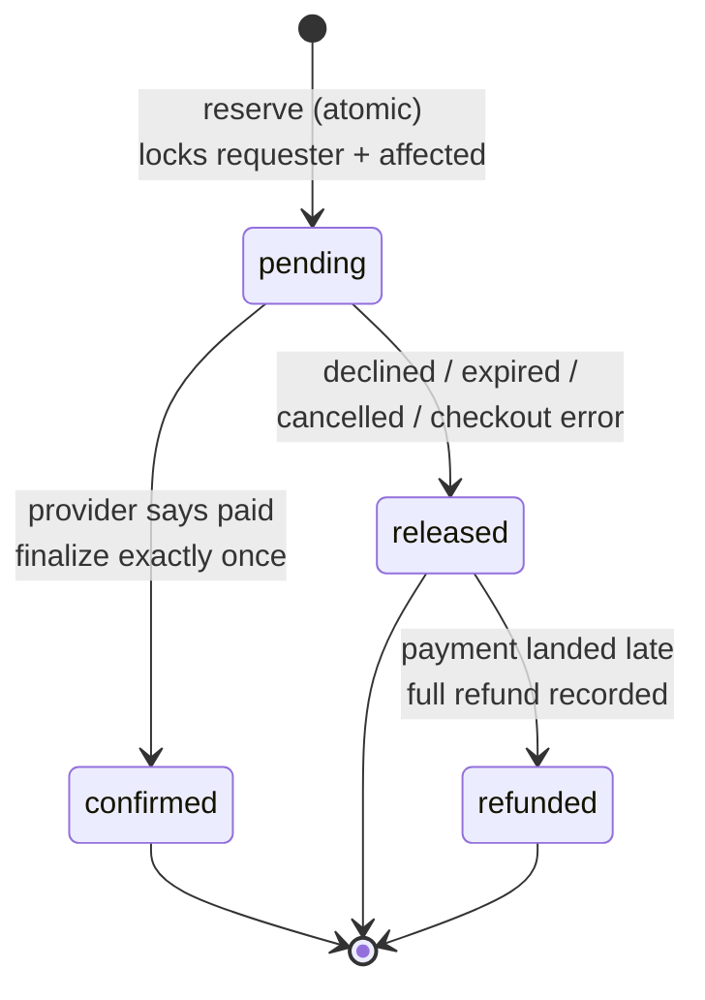
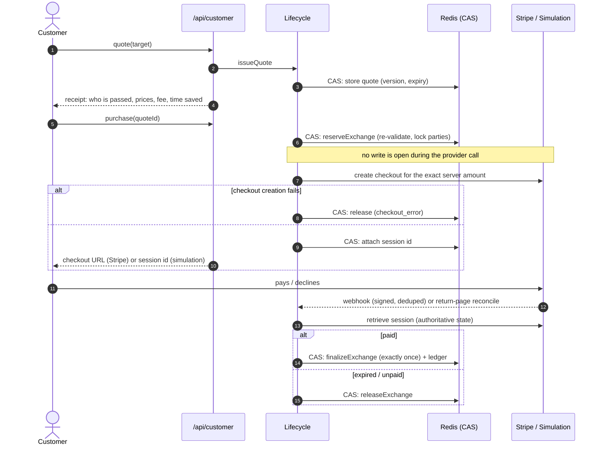

# CHRONOS: time is currency

**A consent-based time exchange for queues.** If you're in a hurry, you pay to go sooner. If you're not, you get paid to wait.

**Live demo:** https://chronos-time-exchange.vercel.app · **Stack:** Next.js 16 · TypeScript · Tailwind CSS 4 · Motion · Zod · Stripe SDK · Upstash Redis · Vitest · Vercel

[](docs/demo/chronos-demo.mp4)

**[Watch the 65-second demo](docs/demo/chronos-demo.mp4)** (the café screen and a customer's phone side by side, with captions).

---

## Contents

1. [The idea](#the-idea)
2. [Try it in 60 seconds](#try-it-in-60-seconds)
3. [The three screens](#the-three-screens)
4. [The economic mechanism](#the-economic-mechanism)
5. [System architecture](#system-architecture)
6. [Exchange lifecycle](#exchange-lifecycle)
7. [Purchase flow](#purchase-flow)
8. [Data model](#data-model)
9. [Consistency and concurrency](#consistency-and-concurrency)
10. [Payments](#payments)
11. [Security](#security)
12. [API reference](#api-reference)
13. [Project structure](#project-structure)
14. [Testing](#testing)
15. [Running locally](#running-locally)
16. [Configuration](#configuration)
17. [Deployment](#deployment)
18. [Design system](#design-system)
19. [Design decisions and trade-offs](#design-decisions-and-trade-offs)
20. [Limitations and roadmap](#limitations-and-roadmap)

---

## The idea

Queues treat everyone's time as equally valuable, but it isn't. Some people are in a rush. Others don't mind waiting a few extra minutes, and would happily take a discount for it.

CHRONOS lets these people trade time openly and fairly:

- **Consent first.** When you join, you decide whether others may pass you, your price per pass, and the most extra waiting you'll accept in total. Nobody is ever passed without agreeing.
- **Transparent pricing.** Someone in a hurry sees one exact price: the sum of what each person they pass asked for, plus a small venue fee.
- **Money follows time.** After the payment is confirmed, the buyer moves up and everyone they passed gets their price off their order, automatically.

A café is the demo setting, but the engine is industry-neutral (*venues*, *parties*, *orders*). It applies to clinics, service counters, pickup lines and any other ordered queue.

## Try it in 60 seconds

1. Open the **[live queue](https://chronos-time-exchange.vercel.app/display)** on a big screen (or one browser tab).
2. Open the **[customer page](https://chronos-time-exchange.vercel.app/customer)** on your phone (scan the QR code on the display) or in another tab.
3. Join as *Daniel*, tap **Move to #1**, review the receipt, then tap **Pay $1.75** → **Approve payment**.
4. Watch the display: Daniel jumps to #1, and Alice, Bob and Charlie each show their discount.
5. Open the **[café console](https://chronos-time-exchange.vercel.app/merchant)** (public demo passcode `chronos-demo`). Click **Call next customer**, then **Finish order & charge**, to see the discounted amount captured.

The demo resets itself after 10 minutes without activity. Payments are **simulated** on the live site: no real money moves, and every screen says so.

## The three screens

| Screen | Path | For | What it does |
| --- | --- | --- | --- |
| **Customer** | `/customer` | Mobile | Join with a name, order and consent settings. Shows your position and wait time, a price for every spot ahead (or why it's unavailable), a 60-second price lock, checkout, receipts, earned discounts and your final bill. |
| **Live queue** | `/display` | Projector / TV | Animated queue (spring layout transitions), wait times, total paid to customers, café revenue, latest purchase banner, a QR code to join. |
| **Café console** | `/merchant` | Staff (passcode) | Call the next customer, then finish and capture the order. Shows purchases waiting for payment (check or cancel), a money trail reconciled against the ledger, totals, finished orders with capture details, and a demo reset. |

| Customer (mobile) | Café console |
| --- | --- |
|  |  |

<details>
<summary>Landing page</summary>



</details>

## The economic mechanism

### Worked example

Four customers are waiting:

| Position | Customer | Order | Lets others pass for | Max extra wait |
| --- | --- | --- | --- | --- |
| 1 | Alice | Flat White $10.00 | $0.50 | 15 min |
| 2 | Bob | Pour Over $12.00 | $0.75 | 15 min |
| 3 | Charlie | Espresso $6.00 | $0.25 | 10 min |
| 4 | Daniel | Cold Brew $8.00 | wants priority | – |

Daniel's quote to move from #4 to #1:

```
  Alice     $0.50   (waits +2m 30s)
  Bob       $0.75   (waits +2m 30s)
  Charlie   $0.25   (waits +2m 30s)
  Café fee  $0.25
  ─────────────────
  Daniel    $1.75   (saves 9m)
```

### Rules

Every quote is computed on the server from the live queue:

- **Affected customers** = everyone between the target position and the requester's current position.
- **Compensation** for each affected customer = their own asking price (`minCompensationCents`).
- **Merchant fee** = a flat venue fee (25¢ in the demo).
- **Total premium** = Σ compensation + merchant fee. This invariant is checked again at reconciliation.
- **Added delay** for each affected customer = the requester's service time. **Time saved** = the sum of the affected customers' service times.
- Each quote also carries the **queue version** and an **expiry** (60 s).

A quote, or the reservation that accepts it, is **rejected** when:

| Rule | Error code |
| --- | --- |
| An affected customer hasn't opted in | `not_consented` |
| Their cumulative added delay would exceed their maximum | `delay_exceeded` |
| The discount would push their order below its minimum charge (max of 50¢ and 50% of the order) | `below_min_charge` |
| The total is below the payment rail minimum (50¢) | `below_payment_minimum` |
| The queue changed since the quote was issued | `stale_version` |
| The quote has expired | `quote_expired` |
| The live re-price differs in any way from the quote | `quote_mismatch` |
| An affected customer is already being served | `party_serving` |
| Someone involved is reserved by another pending exchange | `exchange_conflict` |

All money is **integer cents**: `assertCents` rejects anything that isn't a safe integer, and floating point never touches a price. The engine never re-prices silently. If anything changed, the customer gets a new quote.

## System architecture



**Layers**

| Layer | Location | Responsibility |
| --- | --- | --- |
| Domain engine | `src/domain/` | Pure, deterministic functions over one `VenueState` aggregate. No I/O, no clock, no randomness: time and id generators are injected. |
| Lifecycle service | `src/server/lifecycle.ts` | Orchestrates domain transitions, the store and the payment adapter. It's the only place that talks to the payment provider, and it never does so inside a write. |
| Store | `src/server/store.ts` | `read` and `cas(expectedRev, state)`. Has a Redis implementation (Lua script) and a memory implementation (dev and tests). |
| Payment adapters | `src/server/payments/` | `StripeAdapter` (sandbox only) and `SimulatedAdapter`, behind one interface. |
| HTTP | `src/app/api/` | Zod validation, sessions, response sanitising. |
| UI | `src/components/`, `src/app/` | React client components polling the public state, with Motion layout animations. |

## Exchange lifecycle



- **Reserve** atomically validates the quote (id, owner, expiry, version, live re-price) and locks every party involved. While locked, a party can't change consent, leave, or be called to the counter, so the block being passed stays contiguous until payment resolves.
- **Finalize** moves the buyer in front of the first affected party, applies each discount and added delay, unlocks everyone, bumps the queue version and writes the ledger entries. Calling it again on a confirmed exchange is a no-op (`applied: false`).
- **Release** unlocks everyone and leaves the queue exactly as it was, with no ledger entries.
- **Refund** handles the one unavoidable race: a payment that completes after its reservation was released. It is refunded in full and recorded, and the queue is not touched.

## Purchase flow



Success redirects are never trusted. The return page only asks the server to **reconcile**, and the server reads the session from the provider.

## Data model

One JSON aggregate per venue (`VenueState`, see `src/domain/types.ts`):

| Entity | Key fields |
| --- | --- |
| `VenueConfig` | `merchantFeeCents`, `quoteTtlSec` (60), `reservationTtlSec` (900), `minChargeFloorCents`, `minChargeRatioBps`, `paymentMinimumCents` |
| `Party` | `displayName`, `orderItems`, `orderTotalCents`, `minChargeCents`, `serviceSec`, `status` (`waiting`/`serving`/`served`/`left`), `consent`, `addedDelaySec`, `earnedDiscountCents`, `lockedBy`, `payment`, `tokenHash` |
| `ConsentPolicy` | `optIn`, `minCompensationCents`, `maxAdditionalDelaySec`, `updatedAt` |
| `Quote` | `queueVersion`, `fromPosition`, `targetPosition`, `affected[]` (with a **consent snapshot**), `compensationTotalCents`, `merchantFeeCents`, `totalCents`, `timeSavedSec`, `expiresAt` |
| `Exchange` | `status`, `quote`, `reservationExpiresAt`, `payment` (`provider`, `status`, `sessionId`, `paymentIntentId`, `refundId`), `releaseReason`, `events[]` |
| `LedgerEntry` | `kind` (`priority_premium`, `customer_compensation`, `merchant_fee`, `priority_refund`, `order_authorization`, `order_capture`, `compensation_forfeited`), `amountCents`, `provider`, `providerRef` |
| `OrderPayment` | `none`, `simulated` (authorized → captured) or `stripe` (pending → authorized → capture_pending → captured / capture_failed) |

Top-level fields: `queueVersion` (bumped on any change that could affect a price), `queue` (ordered party ids), `processedEvents` (Stripe event ids), `simulatedSessions`, `seededAt`, `lastActivityAt`.

## Consistency and concurrency

- **One aggregate, compare-and-set.** Every write is *read state + revision → run a pure transition → write only if the revision is unchanged*. In Redis this is a single Lua script, so the check and the write are atomic. On a conflict, the store reloads and **re-runs the transition against the fresh state**, which re-checks every rule.
- **No transaction spans a provider call.** Stripe and the database can't share a transaction, so the design doesn't pretend they do. Each step (reserve → create session → attach → confirm) is its own atomic write and can be safely repeated.
- **One reconciliation path.** Webhooks, the return page, staff actions and a background sweep all call `reconcileExchange`, which reads the provider's authoritative session state and applies the matching transition.
- **Idempotency everywhere.**
  - Finalization is a status transition, so a second call does nothing.
  - Stripe events are deduplicated by event id.
  - Stripe calls use idempotency keys (`chronos-priority-<exchange>`, `chronos-capture-<party>`, `chronos-refund-<exchange>`).
- **Abandoned checkouts.** Stripe sessions must live at least 30 minutes, but reservations last 15. The sweep explicitly expires the session at the provider and releases positions only once the provider confirms it can no longer be paid.
- **Self-healing demo.** After 10 minutes with no activity and nothing pending, the venue re-seeds itself. This is checked again inside the write, so it can't wipe out a purchase that's in flight.

## Payments

| | Simulation adapter (live demo) | Stripe sandbox adapter |
| --- | --- | --- |
| Enabled when | no `STRIPE_SECRET_KEY` | `STRIPE_SECRET_KEY=sk_test_…` |
| Priority purchase | In-app checkout sheet (Approve / Decline), stored in the aggregate | Stripe Checkout session for the exact amount, with `exchange_id` in its metadata |
| Confirmation | Same `reconcileExchange` path | Signed webhook (`checkout.session.*`) + return-page reconcile |
| Order payment | Simulated authorization, captured at the discounted amount | Optional manual-capture authorization at join, partially captured when served |
| Safety | Labelled on every screen | **Live keys refused at startup** (`assertSandboxKey`) |

**Capture checks** (Stripe): the final amount must not exceed the authorization, the authorization must not be past `capture_before`, the PaymentIntent must be `requires_capture` with enough capturable, and each order can be captured once (idempotency key). Failures are recorded as `capture_failed`, and staff can retry from the console.

> The Stripe adapter is implemented, and its logic is exercised by a Stripe-like fake in the tests. The live deployment intentionally runs the simulation adapter, and the Stripe path hasn't been run against real test keys.

## Security

- **Customer sessions.** A 256-bit random token is set as an `httpOnly`, `SameSite=Lax` cookie (`Secure` in production). Only its **SHA-256 hash** is stored, and lookups use a constant-time comparison.
- **Merchant sessions.** A passcode check (constant-time) issues an expiring, **HMAC-SHA256-signed** cookie (`SameSite=Strict`). Every merchant action requires it.
- **Server authority.** Clients send only intents, such as a quote id. Every amount is computed on the server. Clients can never set prices, payment amounts or payment outcomes.
- **Input validation.** Every request body is parsed with **Zod** discriminated unions, with bounds on consent values, names and ids.
- **Response sanitising.** Public state strips token hashes, stored quotes, simulated sessions and processed event ids.
- **Secrets stay on the server.** Stripe keys, the Redis token and the session secret are read only in server modules (`server-only`). Nothing is exposed with a `NEXT_PUBLIC_` prefix.
- **Webhook integrity.** The Stripe signature is verified on the raw request body before any processing.

## API reference

All endpoints return JSON with `Cache-Control: no-store`. Errors are `{ error, code }`, where `code` is a domain error such as `stale_version`.

| Method | Path | Auth | Purpose |
| --- | --- | --- | --- |
| `GET` | `/api/state` | none | Sanitised venue state plus mode (`redis`/`memory`, `simulation`/`stripe_sandbox`). Also sweeps stale pending exchanges. |
| `GET` | `/api/customer` | cookie | Returns the caller's `partyId`, or `null`. |
| `POST` | `/api/customer` | cookie (except `join`) | `join`, `consent`, `leave`, `quote`, `purchase`, `reconcile`, `cancel`, `simulatedCheckout`, `refreshAuthorization`, `restart` |
| `GET` | `/api/merchant` | merchant | Full ledger, totals and per-exchange reconciliation. Unauthenticated callers get `{ authenticated: false }`. |
| `POST` | `/api/merchant` | merchant (except `login`) | `login`, `logout`, `serveNext`, `reset`, `cancelExchange`, `reconcileExchange`, `retryCapture` |
| `POST` | `/api/stripe/webhook` | Stripe signature | Handles `checkout.session.*` for priority purchases and order authorizations. |

Example:

```bash
curl -X POST https://chronos-time-exchange.vercel.app/api/customer \
  -H 'Content-Type: application/json' -c jar -b jar \
  -d '{"action":"quote","target":1}'
```

## Project structure

```
src/
  domain/                 Pure engine (no I/O)
    money.ts              integer-cent helpers, formatting
    types.ts              VenueState, Party, Quote, Exchange, LedgerEntry …
    queue.ts              join, consent, leave, call/complete, wait estimates
    quote.ts              pricing, ladder of offers, quote issuing, equivalence
    exchange.ts           reserve → finalize / release → refund
    reconcile.ts          ledger invariants, venue totals
    demo.ts               demo venue config, menu, seeded customers
    result.ts             Result type and domain error codes
  server/
    store.ts              Store interface, RedisStore (Lua CAS), MemoryStore, mutate()
    lifecycle.ts          the service: join, quote, purchase, reconcile, sweep, webhook, serve, capture
    payments/             PaymentAdapter interface, StripeAdapter, SimulatedAdapter
    auth.ts               customer cookie sessions, merchant HMAC sessions
    runtime.ts            env wiring, public-state sanitising
    seed.ts · http.ts
  app/
    api/                  state · customer · merchant · stripe/webhook
    customer/ display/ merchant/  page entries
    page.tsx              landing: how it works, under the hood
  components/             customer app, live queue, merchant console, QR join
  lib/use-chronos.ts      client hooks (polling, actions)
tests/
  domain.test.ts          pricing and exchange rules
  lifecycle.test.ts       end-to-end lifecycle on memory store + fake provider
supabase/migrations/      equivalent Postgres design (not used; see BUILD_STATE.md)
```

## Testing

```bash
npm test          # 38 tests, deterministic (injected clock and ids)
```

| Area | Covered cases |
| --- | --- |
| Pricing | the canonical $1.75 example, partial moves, money conservation for every target, time saved and added delay |
| Consent and limits | refusal without opt-in, cumulative delay cap, minimum-charge limit, payment minimum, party being served, invalid targets |
| Quote validity | stale version, expiry, wrong requester, live re-price mismatch |
| Reservation | locking, conflicting exchange blocked, consent snapshot recorded, frozen consent / leave / serve while reserved |
| Finalization | exact queue reorder and discounts, applied exactly once, wrong amount rejected, failed payment leaves queue unchanged, late payment refunded |
| Lifecycle | simulated end to end, decline, foreign session rejected, duplicate webhooks + return-page reconciles, concurrent purchases (exactly one reserves), checkout-creation failure, abandoned-checkout expiry, cancel honouring a payment that already succeeded, discounted capture when serving |
| Public demo | second buyer after the first, idle re-seed, no re-seed while a payment is pending |

Also run: `npm run lint`, `npm run typecheck`, `npm run build`.

## Running locally

```bash
git clone https://github.com/MRSHAKILS/Chronos.git
cd Chronos
npm install
npm run dev       # http://localhost:3000
```

Without any environment variables, CHRONOS runs with an **in-memory store** and the **simulation adapter**. That's enough for the whole demo on one machine. Copy `.env.example` to `.env.local` to use Redis or the Stripe sandbox.

For Stripe webhooks locally:

```bash
stripe listen --forward-to localhost:3000/api/stripe/webhook
```

Test card: `4242 4242 4242 4242`, any future expiry, any CVC.

## Configuration

| Variable | Required | Description |
| --- | --- | --- |
| `KV_REST_API_URL`, `KV_REST_API_TOKEN` | for shared state | Upstash Redis REST credentials (set automatically by the Vercel Marketplace integration). `UPSTASH_REDIS_REST_URL`/`_TOKEN` also work. |
| `SESSION_SECRET` | in production | 32+ characters, used to sign merchant sessions. |
| `MERCHANT_PASSCODE` | no | Defaults to `chronos-demo`, which the login page shows publicly. Set it for a private deployment. |
| `STRIPE_SECRET_KEY` | no | Must be a **test** key (`sk_test_…`/`rk_test_…`). Enables the Stripe adapter. |
| `STRIPE_WEBHOOK_SECRET` | with Stripe | Signing secret for `/api/stripe/webhook`. |
| `APP_URL` | no | Canonical origin for Stripe redirect URLs (otherwise derived from the request). |

## Deployment

The live site runs on **Vercel** with **Upstash Redis** from the Vercel Marketplace.

```bash
vercel link
vercel integration add upstash/upstash-kv     # adds KV_* env vars
vercel env add SESSION_SECRET production
vercel deploy --prod
```

The Vercel project is connected to this GitHub repository, so every push to `main` deploys to production and every other branch gets a preview URL.

To enable the Stripe sandbox, add `STRIPE_SECRET_KEY` and `STRIPE_WEBHOOK_SECRET`. Then register `https://<your-domain>/api/stripe/webhook` for the `checkout.session.completed`, `checkout.session.expired`, `checkout.session.async_payment_succeeded` and `checkout.session.async_payment_failed` events.

## Design system

The look is a Swiss editorial layout crossed with a financial terminal, designed to feel like serious infrastructure rather than a template.

| Token | Value | Use |
| --- | --- | --- |
| Ivory | `#F4F3ED` | Background |
| Obsidian | `#141414` | Text, rules, primary buttons |
| Signal orange | `#FF5722` | The buyer, prices, calls to action |
| Emerald | `#16865C` | Compensation, success, reconciliation |
| Space Grotesk | headings | Large tabular position numbers |
| IBM Plex Mono | data | Prices, timers, ledger |
| Inter | body | Explanations |

Fine 1px rules, asymmetric grids, and a light frosted-glass surface for key cards. Motion is used only where it explains something: queue rows reorder with spring layout transitions, discounts fade in where they're earned, and the customer's position number pulses when it changes. The customer page has a four-step progress bar (Join → Choose a spot → Pay → Done), and every number has a plain-language label.

## Design decisions and trade-offs

| Decision | Why |
| --- | --- |
| **Single venue aggregate + compare-and-set** | Gives a serialisable view of a small queue with very little machinery, and makes every rule re-check on retry automatically. Fine for one venue's queue. Very busy venues would want row-level storage. |
| **Upstash Redis instead of Supabase Postgres** | The Supabase account was at its free-project limit, and the existing projects were hibernating, so they couldn't be paused. The Postgres equivalent (RLS on, service-role only) is kept in `supabase/migrations/` for reference but is unused. |
| **Polling instead of websockets** | Reliable on serverless with no connection management. One-second freshness is plenty for a queue. |
| **Flat merchant fee** | Easy to explain on stage. The fee policy is a single config value. |
| **Compensation = the passed customer's own asking price** | No auction or negotiation. The price is known in advance and consented to. |
| **Simulation adapter shares the full lifecycle** | The demo exercises the real state machine and reconciliation code instead of a mock-up. |
| **Public demo passcode** | It's a portfolio demo, so the staff console has to be reachable. The auth mechanism is real; only the default passcode is public. |

## Limitations and roadmap

- The real Stripe sandbox path hasn't been run end to end. It needs test keys and a registered webhook.
- One demo venue. The engine already accepts any venue id; multi-venue routing and configuration are next.
- There's no rate limiting on public endpoints yet.
- Possible extensions: dynamic merchant fees, analytics on time traded, and configurations for other industries (clinics, pickup lines).

See [BUILD_STATE.md](BUILD_STATE.md) for the detailed build log of what is verified and what is pending.
